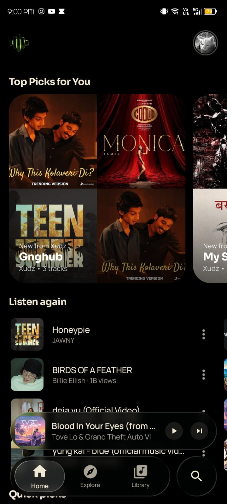
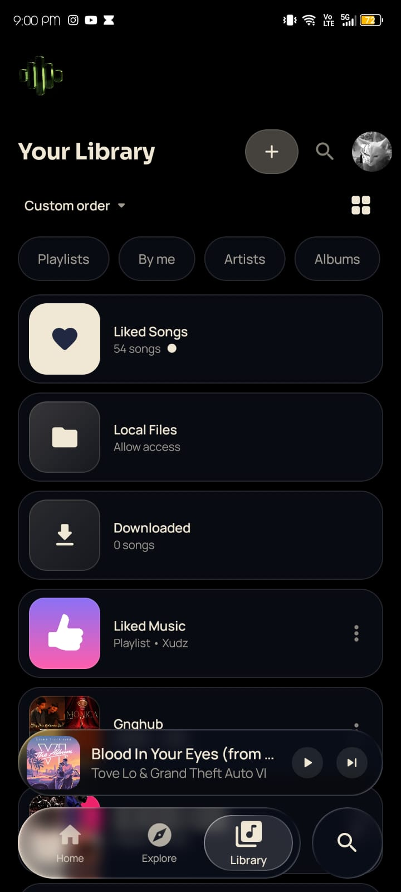
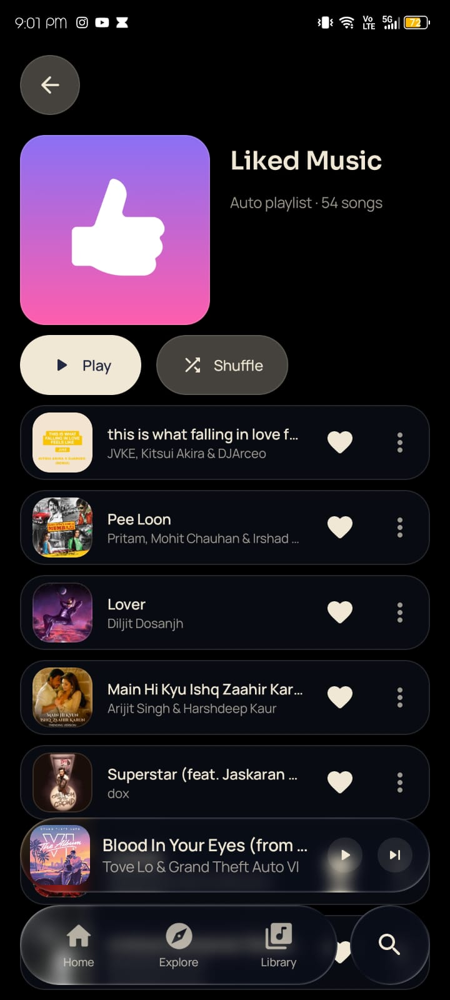
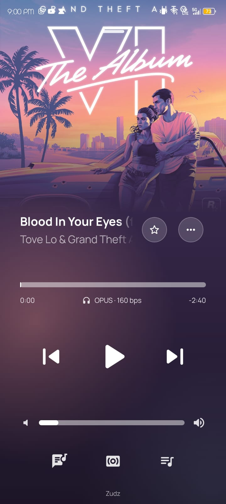
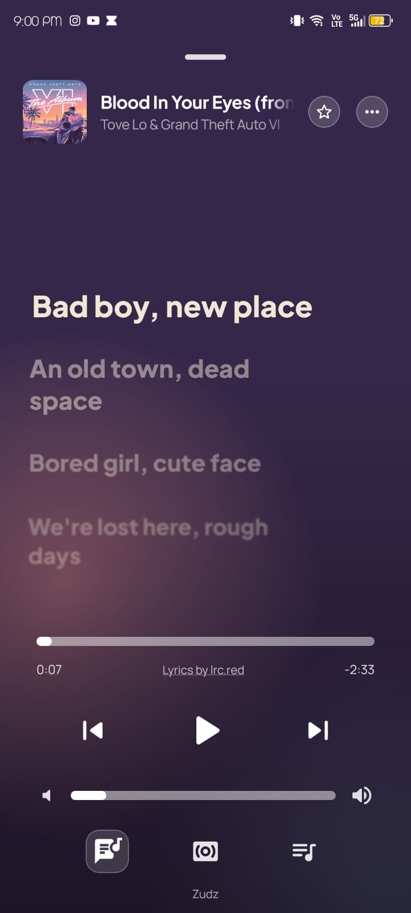

# AURALIS

**A music player for your library, built with a little more atmosphere.**

AURALIS is an Android music player focused on local music, a carefully redesigned listening experience, synced lyrics, and an optional YouTube Music connection.

## Screenshots

Screens from the current AURALIS build:

<table>
  <tr>
    <th>Home and YouTube Music</th>
    <th>Library and glass dock</th>
  </tr>
  <tr>
    <td></td>
    <td></td>
  </tr>
  <tr>
    <th>Liked Music</th>
    <th>Now Playing</th>
  </tr>
  <tr>
    <td></td>
    <td></td>
  </tr>
  <tr>
    <th colspan="2">Word-by-word synced lyrics</th>
  </tr>
  <tr>
    <td colspan="2" align="center"></td>
  </tr>
</table>

## Highlights

- **Redesigned Home screen** with a refreshed layout for getting back to your music and exploring available content.
- **Library screen** for browsing music from folders you choose, with search, favorites, playlists, and queue controls.
- **Glass dock and mini-player** with a floating design that responds as you scroll.
- **Blended Now Playing screen** bringing artwork, playback controls, and lyrics together in one view.
- **Word-by-word synced lyrics** when timing data is available, with line-synced and plain-text lyrics as fallbacks.
- **Multiple lyrics providers**, with provider selection, adjustable text size, and per-song timing offset.
- **Optional YouTube Music integration** for supported search, browsing, playback, and account/library features.
- **Playback tools** including an equalizer, sleep timer, queue, and audio information.
- **Ongoing small bug fixes and reliability improvements.**

## Lyrics

AURALIS can look up lyrics from the enabled providers in Settings. Available sources include lrc.red, BiniLyrics, BetterLyrics, BetterLyrics Portato, LyricsPlus, Unison, KuGou, LRCLIB, YouTube Music lyrics, YouTube captions, and SimpMusic. You can change which sources are enabled in **Settings > Lyrics**.

Synchronized lyrics follow the track when timing data is available. Word-level highlighting depends on the lyrics source and the version it returns.

## YouTube Music

YouTube Music support is optional. Connect an account and enable the integration in Settings to use the supported YouTube Music features. Some features depend on account access and provider availability.

## Download

Check the [Releases](https://github.com/voidXatrix-zudz/Auralis/releases/) section of the GitHub repository for downloadable builds. For source builds, see the instructions below.

## Build from source

**Requirements:** Android 8.0 (API 26) or newer, Android SDK, and JDK 21.

On Windows:

```powershell
.\gradlew.bat :app:assembleDebug
```

On macOS or Linux:

```bash
./gradlew :app:assembleDebug
```

The debug APK is generated at:

```text
app/build/outputs/apk/debug/app-debug.apk
```

## Development status and bug reports

AURALIS is actively developed, so you may still encounter small bugs. I'm fixing issues and improving the app over time. If you find a problem, please open a GitHub issue with your device model, Android version, and steps to reproduce it. Please do not post private account details or tokens.

## Follow AURALIS

- Instagram: **https://www.instagram.com/zudz.irl?jplx=dXRnZDgwbWl4NXZ1**
- Instagram: **https://www.instagram.com/voidzudz.exe?hvrq=MXRxOXNkdHVva2FnZw==**

## Built with

Kotlin, Jetpack Compose, Media3, and Material 3

## License

AURALIS's original code is licensed under **GNU GPL version 3 only**; see [LICENSE](LICENSE). Third-party components retain their own licenses. The vendored Kyant0 Backdrop files remain under **Apache License 2.0**, and the bundled Manrope and Sora fonts remain under **SIL Open Font License 1.1**. See [NOTICE](NOTICE) and the [licenses](licenses/) directory for details and license texts.

## Credits

- Lyrics lookup: [LRCLIB](https://lrclib.net)
- Liquid-glass rendering engine: [Kyant0/AndroidLiquidGlass](https://github.com/Kyant0/AndroidLiquidGlass)
- Made by **Zudz**
